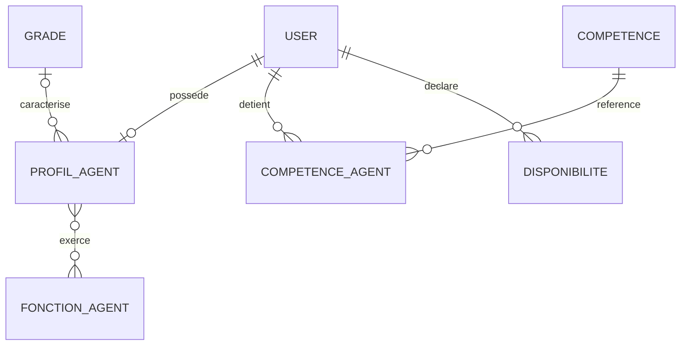

# Modèle de données de Dispo

## Principes

Dispo repose sur une base de données relationnelle SQLite,
gérée par Django.

Les données sont séparées des interfaces et des traitements métier.

Les grades, fonctions, compétences et permissions informatiques
sont indépendants.

## Tables principales

| Modèle | Responsabilité |
| --- | --- |
| User | Identité, matricule, email et authentification |
| ProfilAgent | Informations complémentaires de l'agent |
| Grade | Référentiel des grades |
| FonctionAgent | Référentiel des fonctions |
| Competence | Référentiel des compétences |
| CompetenceAgent | Attribution des compétences aux agents |
| Disponibilite | Créneaux de disponibilité |

## Schéma relationnel

## Identité et authentification

Le compte Django conserve le matricule dans le champ username.

Le matricule est une chaîne de caractères afin de préserver
les éventuels zéros initiaux.

La connexion par matricule ou email sera introduite
dans une évolution ultérieure.

## Profil agent

Le profil complète le compte utilisateur avec :

- Un grade.
- Un numéro de téléphone facultatif.
- Une ou plusieurs fonctions.

Le grade reste temporairement facultatif en base pour permettre
la migration des installations existantes.

## Compétences

Les compétences sont définies dans un catalogue indépendant.

La table CompetenceAgent assure la liaison entre les comptes
agents et les compétences.

Elle conserve les dates de validation et d'expiration,
ainsi que le validateur.

Une même compétence ne peut être attribuée deux fois
au même agent.

## Disponibilités

Les disponibilités sont stockées indépendamment des compétences.

Les moteurs de couverture exploitent ces deux sources
sans modifier leurs données.

## Intégrité et évolutivité

- Préserver les données lors des migrations.
- Éviter la duplication des informations.
- Utiliser des relations entre les tables.
- Ne pas déduire les permissions informatiques du grade.
- Ne pas déduire les compétences du grade.
- Ne pas utiliser de données personnelles réelles dans les tests.

## Validation

Les tests de structure et de migration accompagnent
les évolutions de la base.

Les nouveaux tests métier de couverture seront développés
après la consolidation des référentiels et des interfaces.

Les tests existants restent conservés.

## Évolutions prévues

- Validation des modifications de profil.
- Unicité des adresses email.
- Import et export des agents.
- Gestion collective des compétences.
- Communications internes.
- Gestion des stocks et de la pharmacie.
- Inventaires des véhicules et des matériels.
